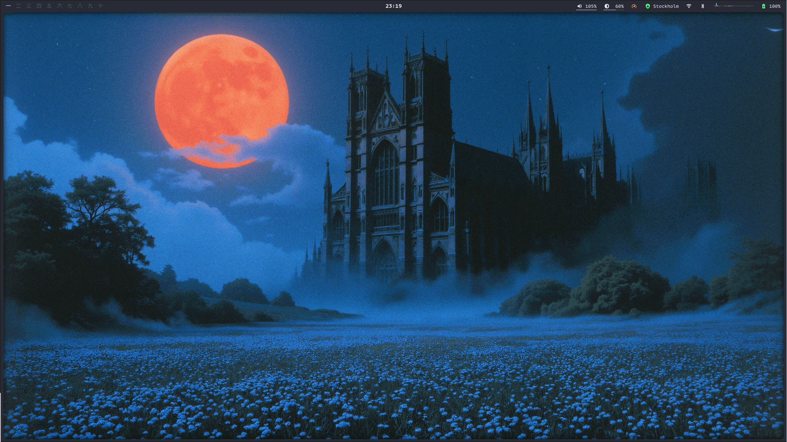
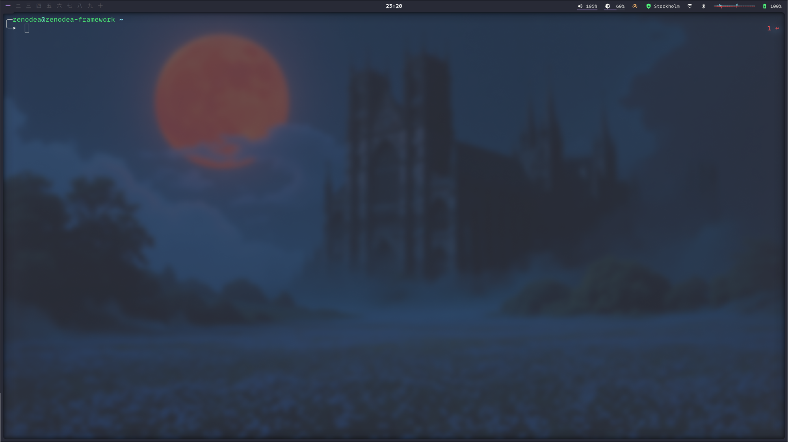
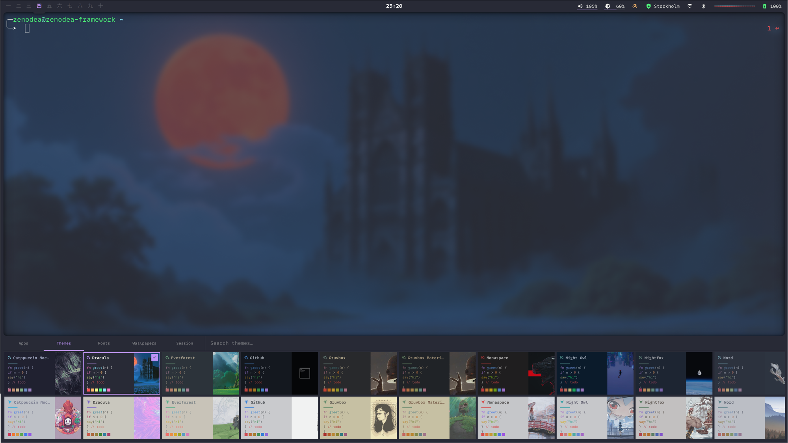
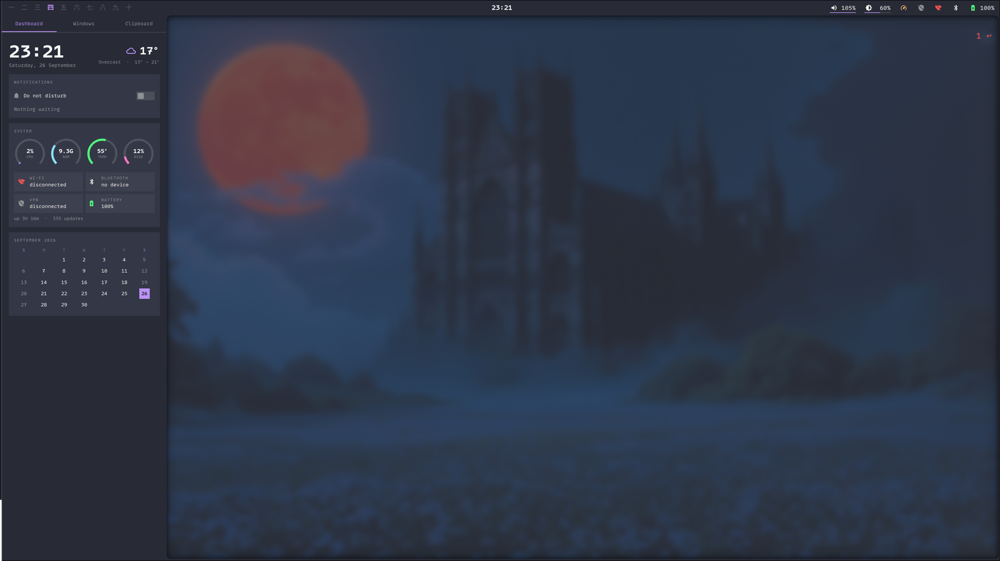
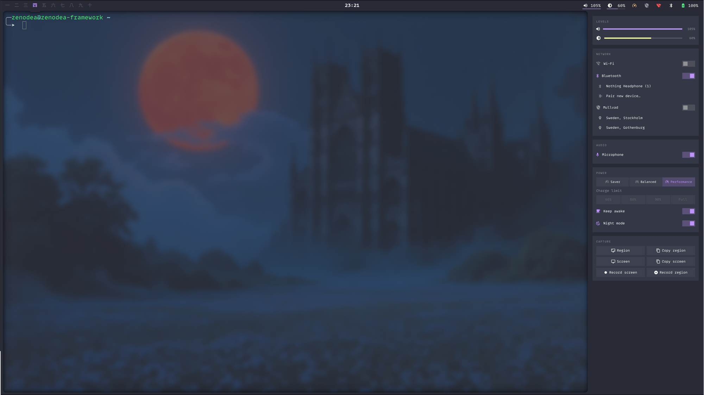
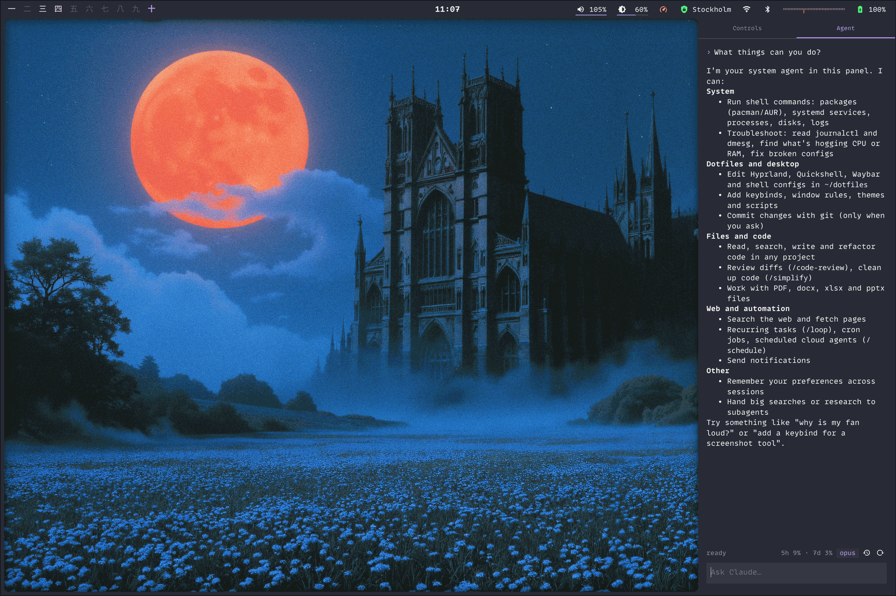
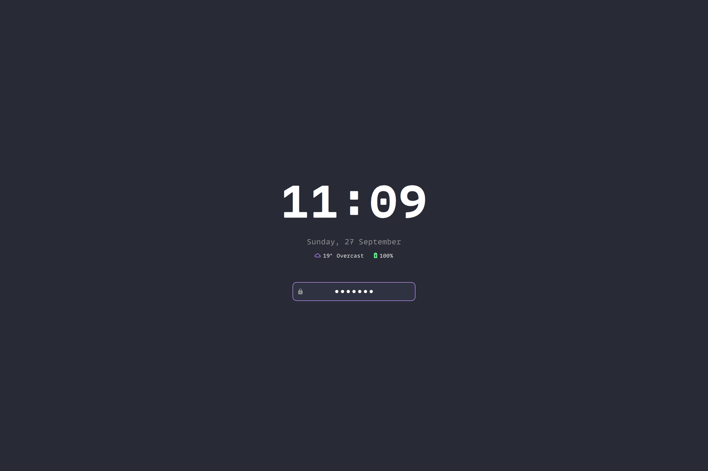

# dotfiles

My configs for Linux (Hyprland) and macOS (AeroSpace), with one theme system
that recolors everything at once.



<table>
  <tr>
    <td width="50%"><br><sub>Ghostty over the blurred wallpaper</sub></td>
    <td width="50%"><br><sub>Launcher, themes tab</sub></td>
  </tr>
  <tr>
    <td width="50%"><br><sub>Drawer: dashboard</sub></td>
    <td width="50%"><br><sub>Control centre</sub></td>
  </tr>
  <tr>
    <td width="50%"><br><sub>Control centre, agent tab</sub></td>
    <td width="50%"><br><sub>Lock screen</sub></td>
  </tr>
</table>

## Install

```sh
git clone --recurse-submodules https://github.com/zenodea/dotfiles_nixless ~/dotfiles
cd ~/dotfiles
bin/install-packages   # optional: Arch, Fedora, Debian or Homebrew
./install.sh
```

`install-packages` picks the script for your OS from `bin/packages/`. You can
also run one of those directly. On Arch it asks before touching the AUR and
defaults to no, fetching the cursor theme, oh-my-zsh and Commit Mono from
upstream instead; pass `--aur` or `--no-aur` to skip the question.

`install.sh` symlinks the configs and the `dotfiles` command, checks out the
wallpapers submodule if it's missing, and renders the current theme. Any file
it would replace gets moved to `<file>.bak` first.

## Layout

```
apps/<general|mac|linux>/<name>/
    app.sh        how to render and reload the app
    templates/    themed config templates
    config/       static config, symlinked to ~/.config/<name>

home/<general|mac|linux>/    mirrors $HOME (.zshrc, scripts/, …)
skills/<name>/SKILL.md       agent skills, symlinked into Claude Code, Codex and pi
themes/<name>.sh             palettes
fonts/<name>.sh              mono fonts
fonts/text/<name>.sh         proportional fonts
bin/                         dotfiles, switch-theme, install-packages
lib/common.sh                helpers shared by bin/ and install.sh
lib/dotfiles/                the dotfiles command's subcommands
wallpapers/                  submodule: github.com/zenodea/wallpapers
screenshots/                 images for this README
```

`general/` is used on both systems, `mac/` and `linux/` only on their own.
Apps without an `app.sh` (lazygit, yazi, aerospace) are only symlinked. Apps
without a `config/` (ghostty, borders, fuzzel) are fully generated and written
straight to `~/.config`.

## Linux shell

The bar, launcher and panels are a [Quickshell](https://quickshell.org) config
in `apps/linux/quickshell/`. It replaced waybar and rofi. Both are still
installed and themed, and the `rofi-dotfiles` and `rofi-power` scripts in
`home/linux/scripts/` still work, but nothing starts them by default.

- **Frame**: bar along the top with workspaces, clock, volume, brightness,
  power profile, VPN, Wi-Fi, Bluetooth, media and battery. It hides for
  fullscreen windows.
- **Launcher** (bottom): apps, themes, fonts, wallpapers and a session page.
- **Drawer** (left): dashboard (clock, weather, notifications, system stats,
  calendar), window list, clipboard history.
- **Control centre** (right): volume, brightness, Wi-Fi, Bluetooth, Mullvad,
  mic, power profile, charge limit, keep awake, night mode, screenshots and
  screen recording.
- **Agent** (right, second tab): a Claude or Codex chat for the system, with
  saved sessions and tool approvals in the panel. `Ctrl P` attaches a
  screenshot, `Ctrl H` opens the session history (type to search, `Ctrl R`
  renames, `Ctrl D` deletes) and `Ctrl S` the settings: agent, model, effort,
  permissions, MCP servers and usage.
- **Lock screen**: the frame's sides close in over the desktop, then the clock,
  weather, battery and password field fade in. hypridle and the session page
  lock through it too.

| Key | |
|---|---|
| `Super Space` / `Super Q` | launcher |
| `Super T` / `Super F` / `Super W` | themes / fonts / wallpapers |
| `Super Shift P` | session |
| `Super D` | dashboard |
| `Super Tab` | windows |
| `Super Shift V` | clipboard |
| `Super C` | control centre |
| `Super A` | agent |
| `Super O` / `Super Shift L` | lock |

The shell reads its colors from a JSON file the theme switch writes, so it
recolors without restarting.

## Themes

```sh
dotfiles --theme <name>     # switch theme (tab-completes)
dotfiles --pick             # pick with fzf
dotfiles --random
dotfiles --list
dotfiles --current
```

Switching re-renders every app's config from its templates and reloads the
apps that are running.

Themed apps: hyprland, hyprlock, quickshell, waybar, fuzzel, rofi, gtk, vifm,
Renux, sketchybar, borders, Alfred, Raycast, Rex, ghostty, tmux, herdr, pi, Claude Code,
Codex, lazygit, delta, nvim, zed, Firefox, Zen (macOS), Hermes, Obsidian,
and the wallpaper.

Themes (each has a `-light` version): ayu, bamboo, blueloco, catppuccin-mocha,
cobalt2, cyberdream, dracula, embark, everforest, flexoki, github, gruvbox,
gruvbox-material, horizon, kanagawa, melange, miasma, monaspace, monokai-pro,
mosel, night-owl, nightfox, nord, nordic, onedark, oxblood, oxocarbon,
prickly-pear, rose-pine, selenized, shades-of-purple, silkcircuit, silverpoint,
solarized-osaka, sonokai, synthwave-84, tokyo-night, witches-brew, zenbones.

Every theme, light halves included, has its own wallpaper; no two share one.

## Fonts

```sh
dotfiles --font <name>          # mono font
dotfiles --text-font <name>     # proportional font
dotfiles --font                 # list mono fonts
dotfiles --text-font            # list text fonts
```

Fonts are separate from themes. The current choice is stored in
`.current-font` and reapplied on every theme switch. A font file looks like
this:

```sh
FONT_MONO_FAMILY="Berkeley Mono"        # ghostty, zed editor, code
FONT_TEXT_FAMILY="IBM Plex Sans Text"   # zed UI, Obsidian, sketchybar labels
FONT_SIZE="14"                          # optional, terminal size
FONT_CELL_HEIGHT="10%"                  # optional, ghostty line height
FONT_CELL_WIDTH="0%"                    # optional, ghostty cell width
```

The mono font goes to ghostty (and so everything in the terminal), zed's
editor, Obsidian code blocks and Firefox's `monospace`. The text font goes to
zed's UI, Obsidian, sketchybar labels, Firefox's UI and its `sans-serif`.
`--text-font` swaps only the text font. Sketchybar icons stay on SF Pro
because they're SF Symbols.

## Light / dark

```sh
dotfiles --auto on          # follow light/dark automatically
dotfiles --auto off
dotfiles --auto             # status
```

A theme counts as light or dark based on how bright its background is. That
also decides terminal opacity and zed's base theme. `gruvbox` is the dark
version and `gruvbox-light` the light one. `--auto on` follows whichever pair
the current theme belongs to.

To add a light version of a theme, add `themes/<name>-light.sh`. Nothing else
needs changing.

On macOS it follows the system appearance, so set Appearance to **Auto** in
System Settings. A launchd agent checks once a minute and only re-renders when
the mode changes. On Linux it goes by the clock: light from 07:00 to 19:00, set
by `DOTFILES_DAY_START` and `DOTFILES_DAY_END`, run by a systemd user timer.
`--auto on` installs the agent or timer and `--auto off` removes it.

If you pick a theme by hand while auto is on, your pick holds until the next
light/dark change. If that theme has a pair, auto switches to following it.

A light theme uses its dark version's `WALLPAPER` unless it sets its own.

`MUTED` (comments, placeholders, line numbers) is worked out from `FG` and
`BG`: it's the faintest color that still has 4.5:1 contrast against the
background. A theme can set `MUTED=` to use its own color instead.

On light themes, any text color under 4.5:1 against `BG` is darkened in Oklab
until it reads, keeping its hue, so every app gets legible accents without a
per-app fix. Ghostty also sets `minimum-contrast = 3` on light themes, which
catches the 24-bit colors that TUIs built for dark terminals send.

Auto mode never changes the macOS system appearance, because setting Light or
Dark by hand turns macOS's Auto off.

### Adding an app

Make `apps/<general|mac|linux>/<name>/` with an `app.sh`:

```sh
render() {                          # paths are relative to this app's dir
    generate config "$HOME/.config/ghostty/config"
}

reload() {                          # optional
    pgrep -x ghostty > /dev/null 2>&1 || return 0
    pkill -SIGUSR2 ghostty
    note "reloaded"
}
```

`generate <template> <dest>` reads from the app's `templates/`. `<dest>` is
either an absolute path or a path inside the app dir (like `config/…`) for
files that get symlinked. A `general/` app that reloads differently on each OS
can define `reload_mac` and `reload_linux`.

`switch-theme` runs each `app.sh` in its own subshell with the palette exported
(`$BG`, `$ACCENT`, `$ACCENT_RGB`, `$THEME_APPEARANCE`, …) and the helpers
`generate`, `copy`, `note`, `skip` and `have`. An app can have only a `reload`
(like `mac/appearance` or `linux/gtk`). If one app fails, it's reported and the
rest still run. `--no-reload` renders without reloading anything.

### Rex and Renux

[Rex](https://rex.superlogical.com) keeps its key bindings on the server, so
[`apps/general/rex/`](apps/general/rex/) links one `init.lua` to `~/.config/rex` on both
systems: the `C-a` prefix, splits, tabs, sessions and popups work the same in
Rex.app on the Mac and in Renux on Linux. A theme switch asks a running server
to read it again; `C-a r` does the same by hand.

The clients are themed apart. [`apps/mac/rex/`](apps/mac/rex/) imports a Ghostty theme file
into Rex.app. [`apps/linux/renux/`](apps/linux/renux/) writes the same kind of file to
`~/.config/renux/themes/dotfiles` and sets the theme, font and opacity in
Renux's `settings.ini`, touching only those keys. Renux watches both files, so
it recolors without a reload.

### Zen (macOS)

[`apps/mac/zen/`](apps/mac/zen/) generates browser-UI CSS in Zen's default profile.
Theme switches apply live: render copies a small autoconfig loader
([`loader/`](apps/mac/zen/loader/)) into `Zen.app/Contents/Resources`, and it
reloads the stylesheet within half a second of a change. This modifies the app
bundle, so `codesign --verify` reports it as altered; Zen updates replace the
bundle, and the next render puts the loader back.

When the running Zen has no loader yet (first install, or right after an
update), changed colors load through a normal quit/reopen, with session
restoration enabled. A closed Zen stays closed; `--no-reload` writes the CSS
without restarting. Cancelled or stalled quits are never force-killed. macOS
may ask permission for Terminal to control Zen on the first restart.

The sidebar, tabs, toolbar, and URL bar follow the palette with native macOS blur
and the terminal's opacity. Websites keep their own styling. Existing unrelated
`userChrome.css` or `user.js` files are left alone rather than overwritten;
`ZEN_PROFILE` can select a profile explicitly.

### Hermes (macOS and Linux)

[`apps/general/hermes/`](apps/general/hermes/) generates a `dotfiles` skin for the default
Hermes home and existing local profiles. Background, text, accents, borders, and
status colors follow the palette; Hermes derives its remaining surface shades
and may adjust the accent for readability. This also themes Hermes CLI/TUI
sessions using those profiles.

The adapter uses Hermes' supported `display.skin` setting and `skins/dotfiles.yaml`,
not app patches or Chromium storage. Its native gateway watcher can apply updates
without restarting active sessions. If a saved desktop theme takes precedence,
select **Dotfiles** once in Hermes' Appearance settings. Remote gateways retain
their own configuration.

`--no-reload` stages the palette without changing Hermes' active files. Publishing
preserves unrelated configuration and backs up each config before its first
change. Unsupported YAML layouts are refused rather than rewritten. A closed
Hermes stays closed. Node.js and the YAML parser from the existing Hermes
installation are required; `HERMES_HOME` selects its data directory and
`HERMES_REPO` can select a nonstandard installation directory.

## Other commands

```sh
dotfiles --wallpaper <name|random>   # change the wallpaper only
dotfiles --update                    # git pull, then reapply the theme
dotfiles --doctor                    # check symlinks, dependencies, drift
dotfiles --save [msg]                # add, commit, push
dotfiles --sync                      # re-run install.sh
```

## Agent harnesses

I use three coding agents: [pi](https://pi.dev), Claude Code and Codex. pi is
the one I shape, because an extension can change anything in it. The other two
only have settings, so they are configured to get as close to pi as those
settings allow. `apps/general/pi/` is the reference; `claude/` and `codex/`
approximate it. When I change how I want an agent to behave, I change pi first
and then mirror what the others can express.

What I'm after, in every harness:

- **One quiet line of status.** Model and effort, context used, permission
  state, active mode. Nothing I don't read: no vendor names, no token counters,
  no path I already know.
- **Nothing moves.** The line I type on stays where it is. The working
  indicator sits on the editor border, the completion list opens above the
  prompt at a fixed height, and sidebar headings stay put.
- **Keyboard first, vim everywhere.** A modal prompt, `ctrl+h/j/k/l` in every
  list, and keys to scroll the transcript and jump back to my last message.
- **Replies shaped for attention.** Result first, progress restated, one next
  step, no tangents. One rules file, `pi/rules/adhd.md`, feeds all three.
- **A judge instead of yolo or prompts.** Fixed rules settle the obvious cases,
  a small model reviews the rest, and I'm asked only about what's left.
- **Themed like everything else.** The harness follows the dotfiles palette.
- **Merge, never overwrite.** Orca, Superset and herdr write hooks into the
  same config files, so each `app.sh` sets its own keys and leaves the rest.
- **Small and mine.** A fifty-line extension beats a plugin I don't control.
  Forks I depend on live in the repo (`pi/team-vendor/`).

How far each one gets:

| | pi | Claude Code | Codex |
|---|---|---|---|
| Status line | `extensions/footer.ts`, drawn on the editor border | `statusline.sh` | `tui.status_line` items |
| Vim prompt | `extensions/modal-editor.ts`: motions, visual mode, transcript scrolling, `[` `]` between my messages | built-in vim mode | built-in vim mode |
| `ctrl+h/j/k/l` in lists | `keybindings.json` | `keybindings.json` (`ctrl+j/k`) | built in |
| Reply style | `/adhd` toggle | `ADHD` output style, switch with `/config` | block in `AGENTS.md`, always on |
| Permissions | policy plus a Haiku judge, `permissions/` | built-in auto mode, same deny rules | `approvals_reviewer = "auto_review"` |
| Theme | rendered from the palette | custom theme rendered from the palette | syntax theme rendered from the palette |
| Working indicator with time and tokens, sidebar, completion box, cursor shape | yes | no | no |

Each harness also gets the shared skills in `skills/`.

## Other apps

- **tmux**: themed config plus git, popup and sessionizer scripts.
- **herdr**: tmux-style keys (`ctrl+a` prefix), themed tab bar, git and sessionizer scripts.
- **pi, Claude Code, Codex**: see [Agent harnesses](#agent-harnesses).
  `apps/general/pi/` links its extensions, rules, keybindings and vendored
  forks into `~/.pi/agent` and adds the packages in `packages.txt`;
  `claude/` and `codex/` merge their settings into `~/.claude` and `~/.codex`.
- **Agent skills**: each `skills/<name>/` with a `SKILL.md` is symlinked into
  `~/.claude/skills`, `~/.codex/skills` and `~/.pi/agent/skills`. Add a
  folder, run `dotfiles --sync`. Skills other tools put in those directories
  are left alone, and links to skills deleted from the repo are removed.
- **Raycast** (macOS): `apps/mac/raycast/extension/` is a Raycast extension for
  the `dotfiles` command: search themes and fonts, set wallpapers, random
  theme, toggle auto, maintenance. See its own README for development.
- **Alfred** (macOS): `apps/mac/alfred/workflows/dotfiles/` is a workflow for
  the same command. `install.sh` symlinks it into Alfred, so edits in the repo
  apply right away. Restart Alfred once after the first install. Type
  `dotfiles`, then:

  | | |
  |---|---|
  | `theme <name>` | switch theme (⇥ to browse) |
  | `wallpaper <name>` | wallpaper only, `random` works |
  | `random` | random theme |
  | `update` / `sync` / `doctor` | output shown in Large Type |
  | `save` | commit and push |

## Notes

- After switching themes on one machine, run `dotfiles --update` on the other.
- Raycast needs Pro, and you have to press ⏎ once in its popup to apply a
  theme.
- Rendered configs are gitignored. Only palettes, templates and
  `.current-theme` are tracked, so a fresh clone has to run `install.sh`.
- `.auto-theme` is tracked so both machines follow the same pair, and
  `install.sh` puts the agent or timer back. The manual-pick pin is local only.
- Auto mode rewrites `.current-theme` twice a day, so the repo shows as
  changed. `--doctor` reports it and `--save` commits it.
